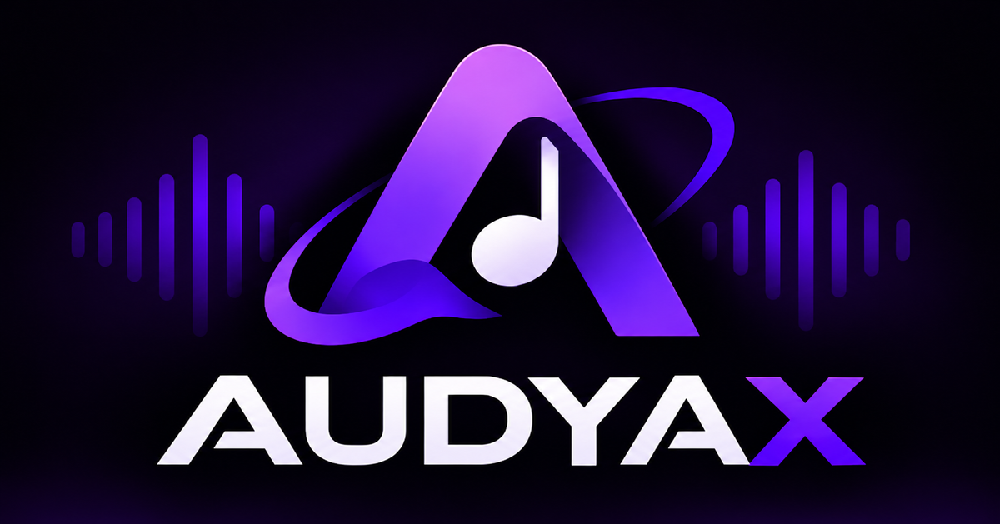

<p align="center">
  
</p>

# AUDYAX
This project aims to develop **Audyax**, a desktop application designed for downloading and managing music from YouTube and YouTube Music. The goal is to provide a tool that allows users to download individual songs or entire playlists, with configurable audio formats and quality settings.

In addition to downloading, the application facilitates music file organization by incorporating metadata such as title, artist, album, and year, as well as embedding cover artwork into downloaded files. It also implements volume normalization and ReplayGain features to provide a more consistent listening experience across different tracks.

The application features a graphical user interface that allows users to view queued songs, monitor download progress, identify successfully downloaded files, and detect potential errors. It also includes options for configuring the destination folder and saving user preferences.

The development is primarily based on Python, using `yt-dlp` as the extraction and download engine, `FFmpeg` for audio processing and conversion, and `Mutagen` for metadata management.

## Features

- Download a single song or a whole playlist (each playlist goes into its own subfolder).
- **YouTube Music playlists and albums** are read the way YouTube Music shows them (with `ytmusicapi`): when the original version of a song was removed or is blocked in your country, YouTube Music silently plays another version; AUDYAX downloads that same playable version and uses YouTube Music's title, artist and album. Radio links (`&list=RD…`) download only that song, not the whole automatic radio.
- **Search by name**: type "artist song" instead of a link, pick the results you want and download them.
- **Clipboard detection**: when the app opens or regains focus, a copied YouTube link is offered with *Paste* / *Download*. Links can also be **dragged and dropped** onto the window (requires `tkinterdnd2`, included in `requirements.txt`).
- Output formats: **MP3**, **M4A**, **Opus** or the **original** audio stream.
- Tags: title, artist, album, year and genre, plus embedded cover art (optionally cropped to a square).
- **ReplayGain** (track and album) written as tags, without touching the audio, or **loudness normalization** (EBU R128, −14 LUFS), which re-encodes the audio. Only one of the two can be active.
- Queue with per-song status (queued / downloading / done / error), thumbnails, progress bar and counters.
- Retry failed songs (they go back to the same playlist subfolder), open link or folder.
- **Queue controls**: **pause / resume** all downloads (the current ones stop where they are and continue later), **cancel a single song** without touching the rest (hover the yellow status icon of a song and click the red ✕, or select it and press *Cancelar* in the detail panel, or right-click it), or cancel everything. A cancelled song can be retried later.
- **Parallel downloads**: 1 to 3 songs at a time (*Configuración → Descargas simultáneas*, 2 by default). Playlists are split into songs so they also download in parallel.
- **Filter and sort the list**: search box (title, artist, album), filter by status (downloaded / in progress / error) and click a column header to sort (click again to reverse, a third time to go back to arrival order). *Select all* and *Limpiar lista* act on the visible rows only, so filtering by "Con error" and pressing *Limpiar lista* removes just the failed ones.
- **Export**: a `.m3u` playlist of the downloaded songs (relative paths, UTF-8) or a `.csv` table of the list (`;`-separated with BOM, opens directly in Excel in Spanish). Both follow the current filter and order.
- **Tag editor**: fix the title, artist, album, year, genre or cover of a downloaded MP3, M4A or Opus file from the detail panel, and **rename the file**. If the file name matches the title, it follows the title as you edit it; type a name yourself to set it independently. Invalid characters are replaced the same way as in downloads, the extension is kept, and an existing file is never overwritten.
- **yt-dlp updates**: YouTube changes often and old yt-dlp versions stop working. AUDYAX checks for a new version on startup (can be turned off in *Configuración*) and updates it with one click; restart the app afterwards.
- Already-downloaded songs are skipped (`descargados.txt`); failures are logged in `faltantes.txt` and `descarga.log`.
- **Optional folder organization** (*Configuración → Organizar descargas*, off by default): keep everything in one folder, or sort songs into `Artist/` or `Artist/Album/` subfolders using their tags. Playlists can still go together in their own folder.
- **Notifications**: a system notification when all downloads finish (only if AUDYAX is not in front). Can be turned off.
- **Keep running in the background**: closing the window (X) keeps AUDYAX running next to the clock in the system tray, still downloading (click the icon to bring it back; right-click for *Pause* / *Exit* to quit for real). Minimizing works as usual. On by default; can be turned off in *Configuración → General*, and then X closes the program (asking first if downloads are in progress).
- **Keyboard shortcuts**: `Ctrl+V` pastes a copied link and starts downloading it, `Supr`/`Delete` removes the selected (or checked) rows from the list (files are not deleted), `Ctrl+F` searches the list.
- **Advanced options** (*Configuración → Avanzado*, all off by default):
  - **Speed limit** in MB/s (total, shared among parallel downloads).
  - **Proxy** (`http://`, `https://`, `socks5://`…), used for downloads, searches and YouTube Music playlists.
  - **Cookies** from your browser session (Firefox recommended) or a `cookies.txt` file, **used only for age-restricted videos**: every song is first tried without them, and only if YouTube asks to confirm the age is that song retried with your session. On Windows, Chrome/Edge and other Chromium browsers no longer let other programs read their cookies, so use Firefox or a `cookies.txt` export. Using your account with download tools may get it rate-limited by YouTube; a secondary account is safer.
- **Lyrics** (*Configuración → Letras y álbum*, off by default): after each song, AUDYAX looks up its lyrics in [LRCLIB](https://lrclib.net) (time-synced when available) and saves them as a `.lrc` file next to the song, inside the file's tags (MP3 `USLT`, M4A `©lyr`, Opus `LYRICS`), or both.
- **Better album, year and cover**: when YouTube doesn't give the album or the year (the "—" in the list), AUDYAX looks the song up in [MusicBrainz](https://musicbrainz.org) and fills them in, and uses the album cover from the [Cover Art Archive](https://coverartarchive.org) instead of the video thumbnail. It is conservative: if the match is not clear (title, artist and duration), nothing is changed. On by default; each part can be turned off. If a service is down, it is skipped for 5 minutes so downloads don't slow down.
- **Mini player**: double-click a downloaded song (or right-click → *Reproducir*) to listen without leaving the app: play/pause, previous/next (following the list as it's filtered and sorted), seek bar, volume (remembered), and the synced lyrics line by line if the song has them. Needs `sounddevice` and `numpy` (in `requirements.txt`; on Linux also `sudo apt install libportaudio2`).
- **Player** (part 2, in progress): **double-click the AUDYAX logo** in the sidebar to switch between the downloader and the player, in the same window (double-click again, or *Inicio*, to go back); a short animation covers the change. The player shows your **library**: every song in your music folder (the download folder by default; *Carpeta…* chooses another one, remembered) as **Canciones**, **Artistas** or **Álbumes**, with a search box (ignores accents and upper/lower case; `Ctrl+F`, `Esc` clears it) and sortable columns. Double-click or `Enter` plays; previous/next follow the table as it's shown. The player bar stays below both views, so the music keeps playing when you switch. Each mode has its own sidebar: the player's has **Reproduciendo**, **Canciones**, **Artistas**, **Álbumes**, **Listas** and **Cola**.
- **Reproduciendo** (also by clicking the cover or title in the player bar; layouts *Equilibrado*, *Portada grande*, *Letra grande* and *Sin letra*, and *Pantalla completa* — `Esc` leaves it; there the player bar merges into the page: progress, play/pause, previous, next, shuffle, repeat and volume are drawn over the background, like on a phone): big cover, the full lyrics (synced ones follow the song, the current line is highlighted and a click on a line jumps there) and the next songs in the queue. If a song has no lyrics, *Buscar letra* finds them on LRCLIB and saves them as the settings say (as an `.lrc` file if lyrics are turned off there, so the song isn't touched).
- **Playlists** (*Listas*): your own lists, saved as `.m3u8` files in a `Listas` folder inside the music folder, so other players can open them too. Create them with *Nueva lista*, from the queue (*Guardar como lista*) or with right-click → *Añadir a una lista* on any song (songs already in the list are skipped). Right-click a list to play, rename or delete it (only the list is deleted, never the songs); `Supr` removes songs from it. Songs that are no longer in their folder stay in the list, marked as not found.
- **Sound** (button with sliders in the player bar): a 10-band **equalizer** with presets (Rock, Pop, Graves+, Voz…) that applies while the song plays; **transition between songs**: a **crossfade** of 1–12 s (2 s by default) or without a gap (the next song is prepared in advance and starts exactly when the previous one ends); and **automatic lyrics** (off by default, turned on in that window): when a song without lyrics starts, they're looked up on LRCLIB and saved as the settings say (`.lrc` if lyrics are turned off there).
- **Appearance** (*Apariencia*, at the bottom of the sidebar): **color schemes** for the whole app (Violeta, Azul, Turquesa, Verde, Ámbar, Rojo, Rosa, Grafito) that apply right away, without restarting; and **one setting for the player's look** — *Reproduciendo*, the player bar and the mini player all use it: **Portada** (the cover very blurred and darkened behind everything, and the cover's colors), **Imagen propia** (a picture of yours, with the scheme's colors) or **Liso** (the plain app background and the scheme's colors).
- **Smart lists** (at the top of *Listas*): *Más escuchadas*, *Escuchadas recientemente* and *Añadidas recientemente* (50 songs each), from a play history kept in `~/.audyax_history.json` (a song counts once it has been heard for 30 s, or half of it if it's shorter). Right-click → *Guardar como lista* turns one into a normal playlist.
- **Tools on any song of the library** (right-click): *Copiar enlace de YouTube* (the link is in the tags of the songs AUDYAX downloaded), *Editar etiquetas…* (the same editor as in the downloader) and *Recortar…*: choose the start and end, optional fade in / fade out, listen to the cut and save it as a copy (`Song (recorte).mp3`) or replacing the original; tags and cover are kept.
- **Mini player** (button in the player bar): a small window always on top with the cover, the song, previous / play-pause / next and the progress; the big window hides until you expand it (button or double click), and it can be dragged anywhere. The **tray icon** menu also has the music controls while a song is loaded.
- **Sleep timer** (moon button in the player bar): stops the music in 15/30/45/60/90 minutes or when the current song ends; the time left is shown next to it.
- **Play queue**: playing a song (in the library or the download list) queues the table as it's shown; right-click a song (or several selected ones) for *Reproducir a continuación* / *Añadir a la cola*. **Shuffle** and **repeat** (queue / one song) buttons in the player bar, remembered. The **Cola** section shows what was played, what's playing and what's next: double-click jumps to a song, `Supr` removes it, *Vaciar cola* empties what's left. The first scan reads every file; later ones (*Actualizar*, or each time the player is shown) only read new or changed files, using a cache in `~/.audyax_library.json`.
- **Watched playlists** (*Vigiladas* in the sidebar): save a playlist or album and AUDYAX checks whether it has new songs (on startup, or with *Revisar*) and downloads only those, to the same folder, using `descargados.txt`. After downloading a playlist, AUDYAX offers to watch it. Optionally, new songs can be downloaded automatically (*Configuración → Descargas*).
- Light and dark themes; settings are saved in `~/.audyax.json` (older versions used `~/.descargador_musica.json`; it is migrated automatically on first start) (tabs *General*, *Descargas*, *Letras y álbum*, *Avanzado*).

## Download (Windows, no Python needed)

Get the latest `AUDYAX-x.y.z-windows.zip` from [Releases](https://github.com/luxkun65/AUDYAX/releases), unzip it anywhere and run `AUDYAX.exe`. FFmpeg is included. When a new version is published, AUDYAX shows a notice on startup.

## Requirements (running from source)

- Python **3.11+**
- [FFmpeg](https://ffmpeg.org/download.html) installed and available in the `PATH`
- On Linux, tkinter and PortAudio (for the mini player): `sudo apt install python3-tk libportaudio2`

## Installation

```bash
git clone https://github.com/luxkun65/AUDYAX.git
cd AUDYAX
python -m venv .venv
# Windows: .venv\Scripts\activate    Linux/macOS: source .venv/bin/activate
pip install -r requirements.txt
```

## Usage

```bash
python main.py
```

Paste a YouTube or YouTube Music link (song or playlist), choose the destination folder, format and options, and press **Descargar**.

> **Note on updates:** updating yt-dlp from the app uses `pip`, so it works when running from source (ideally inside a virtual environment). The packaged executable includes its own copy of yt-dlp; to update it, download a newer AUDYAX release.

> **Note on M4A:** YouTube already serves AAC audio, so M4A is saved as-is, without re-encoding (no quality loss). The quality selector only applies to M4A when normalization is enabled, because then the audio has to be re-encoded.

## Building the executable

```bash
pip install -r requirements-dev.txt
python tools/download_ffmpeg.py    # Windows: downloads FFmpeg (LGPL build) to vendor/ffmpeg
python build.py --zip
```

The program is created in `dist/AUDYAX/` (`AUDYAX.exe` + `_internal/` + `ffmpeg/`) and zipped as `dist/AUDYAX-<version>-windows.zip`. It is a folder rather than a single `.exe` because FFmpeg is over 100 MB: inside a single file it would have to be unpacked on every start. Build it on the same operating system you will run it on.

`AUDYAX.exe --self-test result.json` (or `python main.py --self-test result.json`) starts the program, checks that everything is bundled and that FFmpeg works, writes the result and exits (used by CI).

### Publishing a version

GitHub Actions (`.github/workflows/windows.yml`) runs the tests on Windows, builds the program and self-tests it on every pull request (the zip is downloadable from the run's *Artifacts*). To publish a release:

1. Update `VERSION` in `audyax/__init__.py` (e.g. `1.0.1`) and merge it into `main`.
2. `git tag v1.0.1 && git push origin v1.0.1`

The workflow then attaches the zip to a new GitHub Release.

## Tests

```bash
pip install -r requirements-dev.txt
python -m pytest
```

The tests don't need internet. The ones that generate audio need FFmpeg and are skipped if it isn't installed. They also run automatically on GitHub Actions for every push and pull request.

## Project structure

The code is split in two parts that share a common core, so the music player (part 2) can grow
without touching the downloader:

```
main.py                      entry point (python main.py)
audyax/
  core/                      shared by the downloader and the player; no UI code
    config.py                saved settings and their defaults (+ migration of old settings)
    tags.py                  read/write tags and covers (mutagen), rename files, file info
    replaygain.py            loudness analysis and ReplayGain tags
    lyrics.py                lyrics from LRCLIB, .lrc files, embedded lyrics, LRC parsing
    library.py               player library: folder scan with cache, artists, albums, search, sort
    playlists.py             player playlists (.m3u8 in <music>/Listas): create, read, write, rename, delete
    colors.py                color schemes, cover color, blurred background (no UI)
    history.py               play history for the smart lists (no UI)
    trim.py                  audio cutter with fades, keeping tags and cover (no UI)
    metadata.py              MusicBrainz (album, year) and Cover Art Archive covers
    services.py              circuit breaker for the online services
    system.py                program folder and bundled FFmpeg
  downloader/                part 1: downloading; no UI code (it talks to the UI with events)
    engine.py                yt-dlp options, postprocessors, the download job (run_job)
    youtube.py               YouTube / YouTube Music links and playlists, search by name
    network.py               speed limit, proxy and cookies
    updates.py               yt-dlp and AUDYAX updates
    export.py                .m3u and .csv export
    watched.py               watched playlists: which songs are new
  player/                    part 2: music player
    engine.py                audio engine (FFmpeg -> sounddevice); no UI code
    queue.py                 play queue: order, shuffle, repeat, play next; no UI code
    bar.py                   mini player bar
  gui/                       graphical interface (customtkinter + Pillow)
    app.py                   main window (App) and --self-test
    song_list.py             song list: rows, filter, sort, selection, export
    detail.py                detail panel of the selected song
    settings.py              settings window
    dialogs.py               search results, export and tag editor windows
    watched_window.py        watched playlists window
    player_panel.py          the player bar shared by both views; downloader <-> player switch
    player_view.py           player view (library, playlists, queue) and the logo switch animation
    now_playing.py           player's "Reproduciendo" section (drawn on a canvas over the background)
    np_layout.py             where everything goes in each "Reproduciendo" layout (pure geometry)
    sound_window.py          "Sonido" window: equalizer, gapless/crossfade, automatic lyrics
    appearance_window.py     "Apariencia" window: color scheme, dynamic colors, background
    theming.py               recolors the open interface when the colors change
    trim_window.py           "Recortar" window
    mini_player.py           always-on-top mini player
    desktop.py               system tray icon and notifications (optional)
    style.py, widgets.py     colors, icons, image helpers, small widgets
build.py                     builds the program with PyInstaller (with FFmpeg and the icon)
tools/                       download FFmpeg for the build, generate the icon, CI checks
assets/                      application icon (generated by tools/make_icon.py)
docs/brand/                  logo: emblem (icon source) and banners
tests/                       automated tests (pytest)
```

The files AUDYAX writes in your music folder keep their names: `descargados.txt` (already
downloaded songs), `faltantes.txt` (failures) and `descarga.log`.

## Contributing

- **All code is in English**: names, comments, docstrings and commit messages. Text shown to the
  user (buttons, messages, notifications, the log) stays in Spanish.
- `audyax/core`, `audyax/downloader` and `audyax/player/engine.py` must not import tkinter or
  customtkinter, so they can be tested and reused without a window.
- Run `python -m pytest` before opening a pull request.

## Disclaimer

This tool is intended for personal use. Only download content you have the right to download, and respect YouTube's Terms of Service and the copyright of the artists.

## License

[MIT](LICENSE)
